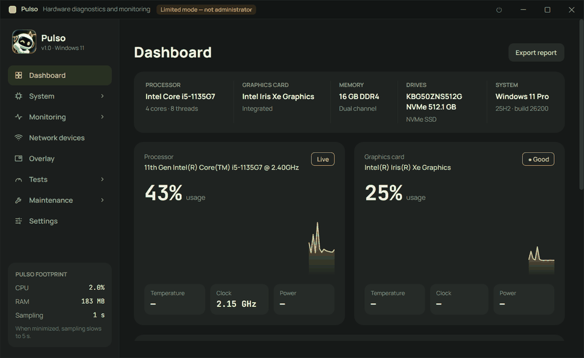
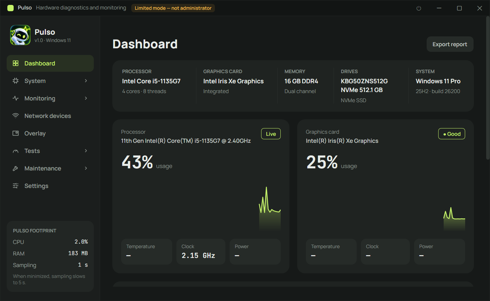
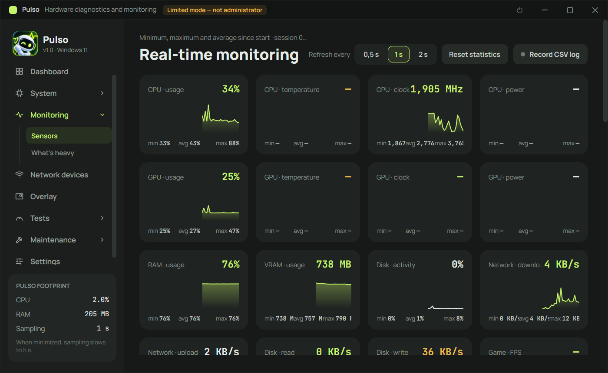
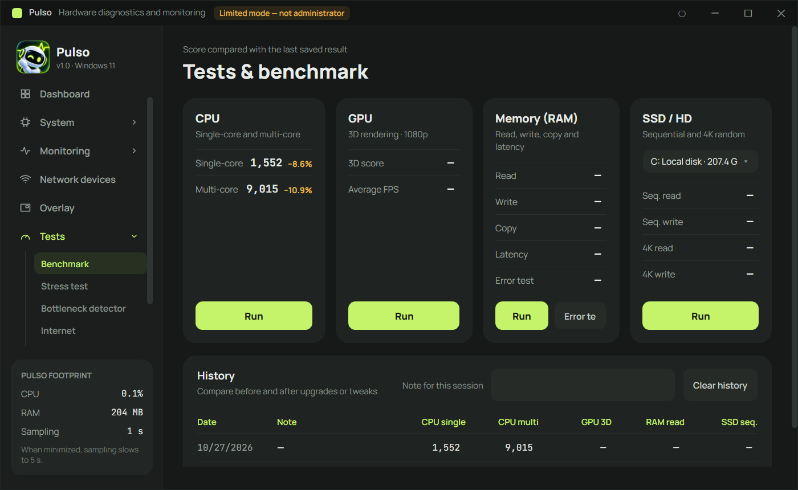

<p align="center">
  
</p>

# Pulso

**English** · [Português (Brasil)](README.pt-BR.md) · [Русский](README.ru.md)

Hardware diagnostics, monitoring and testing for Windows 10/11 and Linux, in a single portable executable.



## Features

- **Dashboard** – CPU, GPU, memory, drives and system at a glance, with live charts.
- **System details** – processor (CPUID, cores, caches, instruction sets), graphics card, RAM (SMBIOS/SPD, XMP/EXPO), storage (SMART), motherboard, network and operating system. Everything can be exported as TXT, HTML or PDF.
- **Real-time monitoring** – usage, temperature, clocks, power, VRAM, disk and network sensors with min/avg/max, temperature alerts and CSV logging.
- **What's heavy** – which apps use the most CPU, memory, disk and GPU right now.
- **In-game overlay** – FPS, frametime, 1% lows, CPU/GPU/RAM/temperature, with nothing injected into the game (anti-cheat safe).
- **Network devices** – finds every device on your network, names and classifies them, shows presence history and warns about new devices.
- **Tests** – CPU, RAM, disk and 3D GPU benchmarks with history, a stress test with automatic safety stop, a bottleneck detector (CPU-bound or GPU-bound) and an internet speed test (download, upload, ping, jitter, packet loss).
- **Maintenance** – Windows repair (DISM + SFC), disk check, cleanup, drive optimization and DNS/network reset.
- **Programs and drivers** – updates through winget; driver updates from Windows Update with a restore point, backup and rollback.
- **Startup apps, crash history and battery health** – what slows down boot, blue screens and unexpected shutdowns with likely causes, and battery wear.
- **Light on resources** – lives in the system tray and slows its sampling when minimized.
- **Three languages** – English, Brazilian Portuguese and Russian (*Settings → Language*, applied after restarting Pulso), plus dark and light themes.

## Screenshots

| Dashboard | Real-time monitoring |
|---|---|
|  |  |



## Supported systems

| System | Status |
|---|---|
| Windows 11 (64-bit) | ✅ Tested |
| Windows 10 (64-bit) | ⚠️ Expected to work, not tested yet |
| Linux (64-bit, X11/Wayland desktop) | ✅ Runs (Avalonia UI). maintenance and updates use your distro's tools (see below); Windows-only features (DISM/SFC, winget, Windows driver updates, ETW-based FPS, PawnIO, startup apps, crash history) are not available |
| macOS | ❌ Not supported |

## Running

Pulso runs on Windows 10/11 (64-bit) and Linux (64-bit).

### Windows

- **Using the executable:** open `dist\Pulso.exe` (see [Where to find the build](#where-to-find-the-build)). It is portable: nothing to install and no .NET needed on the machine.
- **From source:** with the [.NET 10 SDK](https://dotnet.microsoft.com/download) installed:

  ```powershell
  dotnet run --project src/Pulso
  ```

On start Pulso asks for administrator permission, which is needed for temperatures, disk SMART, RAM timings and FPS. If you decline, it runs in limited mode.

For CPU temperature, power and voltage, motherboard sensors and RAM timings, install the free **PawnIO** driver in *Settings → Sensors*. The app installs it through winget and restarts itself.

Command-line options: `--minimized` (start in the tray), `--no-elevate` (don't ask for administrator), `--page <id>` (open a specific page).

### Linux

Install the [.NET 10 SDK](https://dotnet.microsoft.com/download) (or just the runtime, to run a build), then from the repository root:

```bash
dotnet run --project src/Pulso
```

Or build a self-contained executable that needs no .NET on the target machine:

```bash
cd src/Pulso
dotnet publish -c Release -r linux-x64 --self-contained true -p:PublishSingleFile=true \
  -p:IncludeNativeLibrariesForSelfExtract=true -p:EnableCompressionInSingleFile=true -p:DebugType=none -o ../../dist
chmod +x ../../dist/Pulso
../../dist/Pulso
```

Notes for Linux:

- It runs as a normal user; no administrator prompt. Some sensors and SMART data may need `sudo` or read access to `/sys` and the disk devices.
- "Start with the system" creates `~/.config/autostart/pulso.desktop`, which works on GNOME, KDE, Xfce and other freedesktop desktops.
- The same command-line options (`--minimized`, `--page <id>`) work.
- **Repair & cleanup** uses your distro's tools: package integrity (`debsums -s` / `rpm -Va` / `pacman -Qkk`, instead of SFC), drive health (`smartctl`) and TRIM (`fstrim`), cleanup of trash, thumbnails, caches, journal and package cache, DNS flush and network service restart.
- **Programs** updates system packages (apt, dnf, pacman or zypper), Flatpak, Snap and firmware (`fwupdmgr`), plus NVIDIA/proprietary drivers on Ubuntu (`ubuntu-drivers`). It replaces winget and Windows driver updates.
- Actions that need administrator ask for your password through `pkexec` (polkit). Optional tools: `debsums`, `smartmontools`, `flatpak`, `fwupd`; buttons for tools that aren't installed are disabled, and *Install debsums* / *Install smartmontools* buttons install them in one click.

## Building

Requires the .NET SDK 10 on Windows or Linux.

```powershell
dotnet build Pulso.sln -c Release
```

### Generating the executable

On Windows, this creates a single self-contained `Pulso.exe` (no .NET required to run it):

```powershell
cd src\Pulso
dotnet publish -c Release -r win-x64 --self-contained true -p:PublishSingleFile=true `
  -p:IncludeNativeLibrariesForSelfExtract=true -p:EnableCompressionInSingleFile=true -p:DebugType=none -o ..\..\dist
```

### Where to find the build

| What | Where |
|---|---|
| Single-file executable (`publish` above) | `dist\Pulso.exe` (Windows) or `dist/Pulso` (Linux) |
| Regular build (`dotnet build -c Release`) | `src\Pulso\bin\Release\net10.0\win-x64\` (Windows) or `src/Pulso/bin/Release/net10.0/linux-x64/` (Linux) |

`dist\` is not versioned in git: whoever wants the executable builds it with the command above.

## Tests

The unit tests (xUnit) live in `tests/Pulso.Tests` and cover formatting, JSON, settings, localization and LAN helpers. Run them from the terminal:

```powershell
dotnet test
```

GitHub Actions runs the build and the tests on every push to `main` and on every pull request (`.github/workflows/ci.yml`).

## Project structure

| Folder | Contents |
|---|---|
| `src/Pulso/Hardware/` | `SensorHub`: one thread reads all sensors (LibreHardwareMonitor + NVML) and publishes readings |
| `src/Pulso/Info/` | Static information: CPU (CPUID), GPU (DXGI/D3D12/Vulkan/OpenGL/PCIe), RAM (SMBIOS/SPD), drives (SMART), motherboard, network, Windows |
| `src/Pulso/Bench/` | CPU/RAM/disk/GPU (Direct3D 11) benchmarks and the stress-test engine |
| `src/Pulso/Features/` | FPS via ETW, overlay, alerts, CSV log, bottleneck detector, internet test, TXT/HTML/PDF reports, start with Windows |
| `src/Pulso/Views/` | Pages (the "Pulso" design: graphite + lime, Manrope + JetBrains Mono) |
| `src/Pulso/Core/` | Formatting, settings, JSON, localization (`Loc`, with the Russian dictionary in `Loc.Ru.cs`) |
| `tests/Pulso.Tests/` | Unit tests |

User data: `%AppData%\Pulso` (settings and history) and `Documents\Pulso` (CSV logs and reports).
