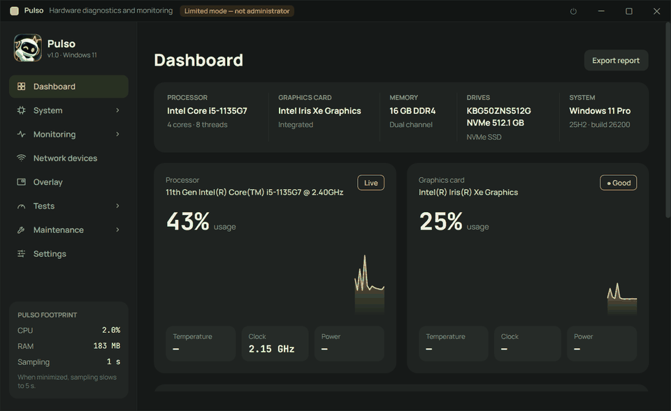
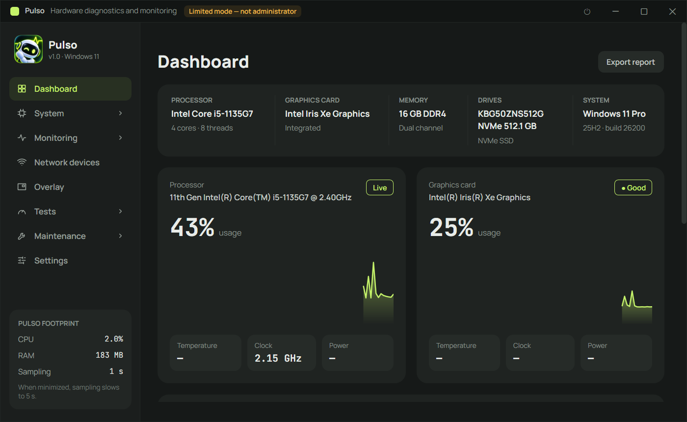
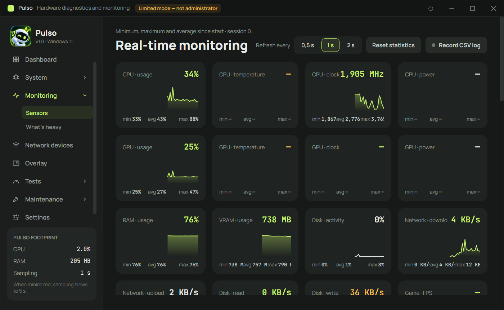
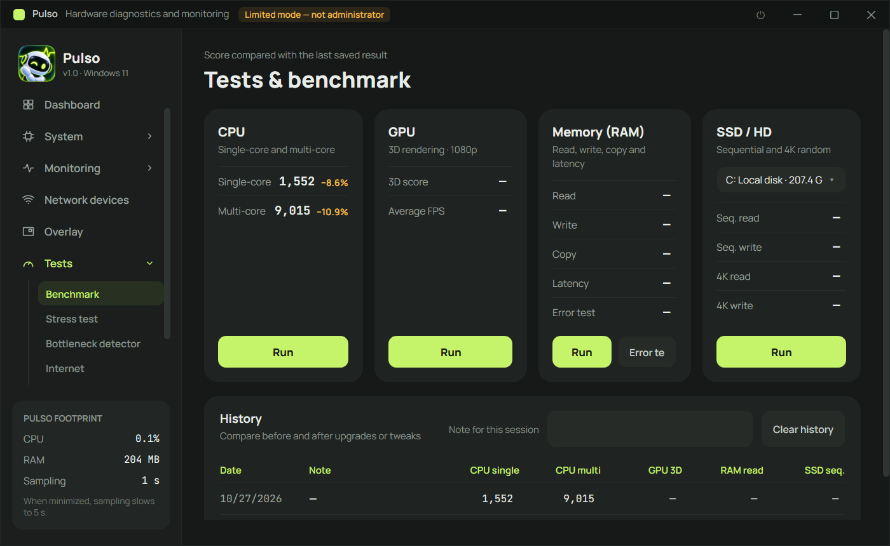

<p align="center">
  
</p>

# Pulso

[English](README.md) · **Português (Brasil)** · [Русский](README.ru.md)

Diagnóstico, monitoramento e teste de hardware para Windows 10 e 11, em um único executável portátil.



## Funcionalidades

- **Painel** – CPU, placa de vídeo, memória, discos e sistema de relance, com gráficos ao vivo.
- **Detalhes do sistema** – processador (CPUID, núcleos, caches, conjuntos de instruções), placa de vídeo, RAM (SMBIOS/SPD, XMP/EXPO), armazenamento (SMART), placa-mãe, rede e sistema operacional. Tudo pode ser exportado em TXT, HTML ou PDF.
- **Monitoramento em tempo real** – sensores de uso, temperatura, clock, consumo, VRAM, disco e rede com mínimo/média/máximo, alertas de temperatura e log em CSV.
- **O que está pesando** – quais programas mais usam CPU, memória, disco e GPU agora.
- **Overlay em jogos** – FPS, frametime, 1% mínimo, CPU/GPU/RAM/temperatura, sem injetar nada no jogo (seguro para anti-cheat).
- **Aparelhos na rede** – encontra todos os dispositivos da rede, dá nome e classifica, mostra o histórico de presença e avisa sobre aparelhos novos.
- **Testes** – benchmarks de CPU, RAM, disco e GPU 3D com histórico, teste de estresse com parada de segurança automática, detector de gargalo (limitado por CPU ou GPU) e teste de internet (download, upload, ping, jitter, perda de pacotes).
- **Manutenção** – reparo do Windows (DISM + SFC), verificação de disco, limpeza, otimização de unidades e reset de DNS/rede.
- **Programas e drivers** – atualizações pelo winget; atualização de drivers pelo Windows Update com ponto de restauração, backup e reversão.
- **Inicialização, histórico de travamentos e bateria** – o que atrasa o boot, telas azuis e desligamentos inesperados com as causas prováveis, e desgaste da bateria.
- **Leve** – fica na bandeja do sistema e reduz a leitura quando minimizado.
- **Três idiomas** – inglês, português do Brasil e russo (*Configurações → Idioma*, vale ao reabrir o Pulso), além dos temas escuro e claro.

## Capturas de tela

| Painel | Monitoramento em tempo real |
|---|---|
|  |  |



> As capturas estão com a interface em inglês.

## Sistemas compatíveis

| Sistema | Situação |
|---|---|
| Windows 11 (64 bits) | ✅ Testado |
| Windows 10 (64 bits) | ⚠️ Deve funcionar, ainda não testado |
| macOS | ❌ Não suportado: o Pulso usa WPF e APIs exclusivas do Windows, então não roda lá |
| Linux | ❌ Não suportado, pelo mesmo motivo |

## Como rodar

O Pulso precisa do Windows 10 ou 11 (64 bits).

- **Pelo executável:** abra `dist\Pulso.exe` (veja [Onde encontrar o build](#onde-encontrar-o-build)). É portátil: não precisa instalar nem ter o .NET na máquina.
- **Pelo código-fonte:** com o [SDK do .NET 10](https://dotnet.microsoft.com/download) instalado:

  ```powershell
  dotnet run --project src/Pulso
  ```

Ao abrir, o Pulso pede permissão de administrador, necessária para temperaturas, SMART dos discos, timings da RAM e FPS. Se você recusar, ele roda em modo limitado.

Para temperatura, consumo e voltagem da CPU, sensores da placa-mãe e timings da RAM, instale o driver gratuito **PawnIO** em *Configurações → Sensores*. O app instala pelo winget e reinicia sozinho.

Parâmetros: `--minimized` (inicia na bandeja), `--no-elevate` (não pede administrador), `--page <id>` (abre numa tela).

## Como compilar

Requer o SDK do .NET 10 no Windows.

```powershell
dotnet build Pulso.sln -c Release
```

### Gerar o executável

Cria um único `Pulso.exe` autocontido (não precisa de .NET para rodar):

```powershell
cd src\Pulso
dotnet publish -c Release -r win-x64 --self-contained true -p:PublishSingleFile=true `
  -p:IncludeNativeLibrariesForSelfExtract=true -p:EnableCompressionInSingleFile=true -p:DebugType=none -o ..\..\dist
```

### Onde encontrar o build

| O quê | Onde |
|---|---|
| Executável único (`publish` acima) | `dist\Pulso.exe` |
| Build comum (`dotnet build -c Release`) | `src\Pulso\bin\Release\net10.0-windows\win-x64\` |

A pasta `dist\` não é versionada no git: quem quiser o executável gera com o comando acima.

## Testes

Os testes unitários (xUnit) ficam em `tests/Pulso.Tests` e cobrem formatação, JSON, configurações, idiomas e utilitários da rede local. Para rodar pelo terminal:

```powershell
dotnet test
```

O GitHub Actions roda o build e os testes a cada push na `main` e em cada pull request (`.github/workflows/ci.yml`).

## Estrutura do projeto

| Pasta | Conteúdo |
|---|---|
| `src/Pulso/Hardware/` | `SensorHub`: uma thread lê todos os sensores (LibreHardwareMonitor + NVML) e publica as leituras |
| `src/Pulso/Info/` | Informações estáticas: CPU (CPUID), GPU (DXGI/D3D12/Vulkan/OpenGL/PCIe), RAM (SMBIOS/SPD), discos (SMART), placa-mãe, rede, Windows |
| `src/Pulso/Bench/` | Benchmarks de CPU/RAM/disco/GPU (Direct3D 11) e motor do teste de estresse |
| `src/Pulso/Features/` | FPS via ETW, overlay, alertas, log CSV, detector de gargalo, teste de internet, relatórios TXT/HTML/PDF, inicialização com o Windows |
| `src/Pulso/Views/` | Telas (design "Pulso": grafite + limão, Manrope + JetBrains Mono) |
| `src/Pulso/Core/` | Formatação, configurações, JSON, idiomas (`Loc`, com o dicionário russo em `Loc.Ru.cs`) |
| `tests/Pulso.Tests/` | Testes unitários |

Dados do usuário: `%AppData%\Pulso` (configurações e históricos) e `Documentos\Pulso` (logs CSV e relatórios).
