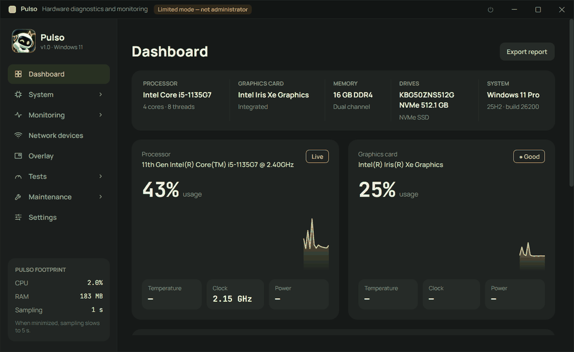
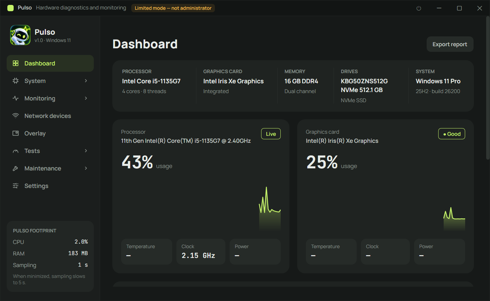
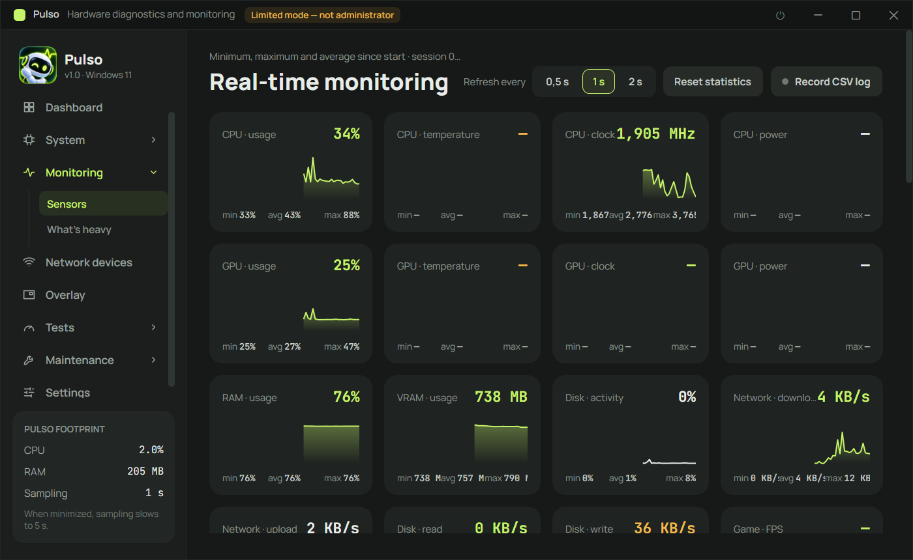
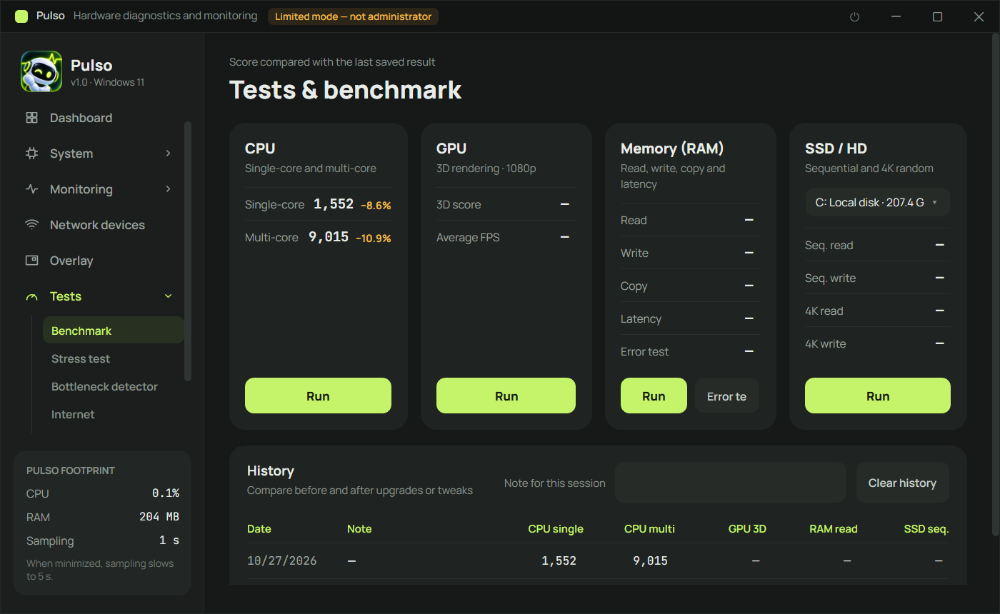

<p align="center">
  
</p>

# Pulso

[English](README.md) · [Português (Brasil)](README.pt-BR.md) · **Русский**

Диагностика, мониторинг и тестирование оборудования для Windows 10/11 и Linux в одном портативном исполняемом файле.



## Возможности

- **Панель** – CPU, видеокарта, память, диски и система на одном экране, с графиками в реальном времени.
- **Сведения о системе** – процессор (CPUID, ядра, кэши, наборы инструкций), видеокарта, ОЗУ (SMBIOS/SPD, XMP/EXPO), накопители (SMART), материнская плата, сеть и операционная система. Всё можно экспортировать в TXT, HTML или PDF.
- **Мониторинг в реальном времени** – датчики загрузки, температуры, частот, мощности, VRAM, диска и сети с мин/сред/макс, оповещения о температуре и запись журнала в CSV.
- **Что нагружает систему** – какие приложения сейчас больше всего используют CPU, память, диск и GPU.
- **Оверлей в играх** – FPS, время кадра, 1% минимум, CPU/GPU/ОЗУ/температура; в игру ничего не внедряется (безопасно для античитов).
- **Сетевые устройства** – находит все устройства в сети, называет и классифицирует их, показывает историю присутствия и предупреждает о новых устройствах.
- **Тесты** – бенчмарки CPU, ОЗУ, диска и 3D-GPU с историей, стресс-тест с автоматической защитной остановкой, детектор узких мест (ограничение по CPU или GPU) и тест скорости интернета (загрузка, отдача, пинг, джиттер, потеря пакетов).
- **Обслуживание** – восстановление Windows (DISM + SFC), проверка диска, очистка, оптимизация дисков и сброс DNS/сети.
- **Программы и драйверы** – обновления через winget; обновление драйверов из Центра обновления Windows с точкой восстановления, резервной копией и откатом.
- **Автозагрузка, история сбоев и состояние батареи** – что замедляет загрузку, синие экраны и неожиданные выключения с вероятными причинами, износ батареи.
- **Экономичность** – работает в системном трее и замедляет опрос в свёрнутом виде.
- **Три языка** – английский, бразильский португальский и русский (*Настройки → Язык*, применяется после перезапуска Pulso), а также тёмная и светлая темы.

## Скриншоты

| Панель | Мониторинг в реальном времени |
|---|---|
|  |  |



> На скриншотах интерфейс на английском.

## Поддерживаемые системы

| Система | Статус |
|---|---|
| Windows 11 (64-bit) | ✅ Протестировано |
| Windows 10 (64-bit) | ⚠️ Должно работать, ещё не тестировалось |
| Linux (64-разрядный, рабочий стол X11/Wayland) | ✅ Работает (интерфейс Avalonia). Функции только для Windows (восстановление DISM/SFC, winget, обновление драйверов, FPS через ETW, PawnIO) недоступны |
| macOS | ❌ Не поддерживается |

## Запуск

Pulso работает в 64-разрядных Windows 10/11 и Linux.

### Windows

- **Из исполняемого файла:** откройте `dist\Pulso.exe` (см. [Где найти сборку](#где-найти-сборку)). Он портативный: ничего устанавливать и иметь .NET на компьютере не нужно.
- **Из исходного кода:** при установленном [.NET 10 SDK](https://dotnet.microsoft.com/download):

  ```powershell
  dotnet run --project src/Pulso
  ```

При запуске Pulso запрашивает права администратора — они нужны для температур, SMART дисков, таймингов ОЗУ и FPS. Если отказаться, приложение работает в ограниченном режиме.

Для температуры, мощности и напряжения CPU, датчиков материнской платы и таймингов ОЗУ установите бесплатный драйвер **PawnIO** в *Настройки → Датчики*. Приложение установит его через winget и перезапустится само.

Параметры командной строки: `--minimized` (запуск в трей), `--no-elevate` (не запрашивать права администратора), `--page <id>` (открыть нужную страницу).

### Linux

Установите [.NET 10 SDK](https://dotnet.microsoft.com/download) (или только runtime для запуска готовой сборки), затем из корня репозитория:

```bash
dotnet run --project src/Pulso
```

Или соберите автономный исполняемый файл, которому .NET на компьютере не нужен:

```bash
cd src/Pulso
dotnet publish -c Release -r linux-x64 --self-contained true -p:PublishSingleFile=true \
  -p:IncludeNativeLibrariesForSelfExtract=true -p:EnableCompressionInSingleFile=true -p:DebugType=none -o ../../dist
chmod +x ../../dist/Pulso
../../dist/Pulso
```

Примечания для Linux:

- Работает от обычного пользователя, права администратора не запрашиваются. Для некоторых датчиков и SMART могут понадобиться `sudo` или доступ на чтение к `/sys` и дисковым устройствам.
- «Запуск вместе с системой» создаёт `~/.config/autostart/pulso.desktop`; это работает в GNOME, KDE, Xfce и других freedesktop-средах.
- Те же параметры (`--minimized`, `--page <id>`) работают.

## Сборка

Нужен .NET SDK 10 в Windows или Linux.

```powershell
dotnet build Pulso.sln -c Release
```

### Создание исполняемого файла

В Windows создаёт один автономный `Pulso.exe` (для запуска .NET не требуется):

```powershell
cd src\Pulso
dotnet publish -c Release -r win-x64 --self-contained true -p:PublishSingleFile=true `
  -p:IncludeNativeLibrariesForSelfExtract=true -p:EnableCompressionInSingleFile=true -p:DebugType=none -o ..\..\dist
```

### Где найти сборку

| Что | Где |
|---|---|
| Единый исполняемый файл (`publish` выше) | `dist\Pulso.exe` (Windows) или `dist/Pulso` (Linux) |
| Обычная сборка (`dotnet build -c Release`) | `src\Pulso\bin\Release\net10.0\win-x64\` (Windows) или `src/Pulso/bin/Release/net10.0/linux-x64/` (Linux) |

Папка `dist\` не хранится в git: кому нужен исполняемый файл, собирает его командой выше.

## Тесты

Модульные тесты (xUnit) находятся в `tests/Pulso.Tests` и покрывают форматирование, JSON, настройки, локализацию и вспомогательные функции локальной сети. Запуск из терминала:

```powershell
dotnet test
```

GitHub Actions выполняет сборку и тесты при каждом push в `main` и в каждом pull request (`.github/workflows/ci.yml`).

## Структура проекта

| Папка | Содержимое |
|---|---|
| `src/Pulso/Hardware/` | `SensorHub`: один поток читает все датчики (LibreHardwareMonitor + NVML) и публикует показания |
| `src/Pulso/Info/` | Статическая информация: CPU (CPUID), GPU (DXGI/D3D12/Vulkan/OpenGL/PCIe), ОЗУ (SMBIOS/SPD), диски (SMART), материнская плата, сеть, Windows |
| `src/Pulso/Bench/` | Бенчмарки CPU/ОЗУ/диска/GPU (Direct3D 11) и движок стресс-теста |
| `src/Pulso/Features/` | FPS через ETW, оверлей, оповещения, журнал CSV, детектор узких мест, тест интернета, отчёты TXT/HTML/PDF, автозапуск с Windows |
| `src/Pulso/Views/` | Экраны (дизайн «Pulso»: графит + лайм, Manrope + JetBrains Mono) |
| `src/Pulso/Core/` | Форматирование, настройки, JSON, локализация (`Loc`, русский словарь в `Loc.Ru.cs`) |
| `tests/Pulso.Tests/` | Модульные тесты |

Данные пользователя: `%AppData%\Pulso` (настройки и история) и `Документы\Pulso` (журналы CSV и отчёты).
